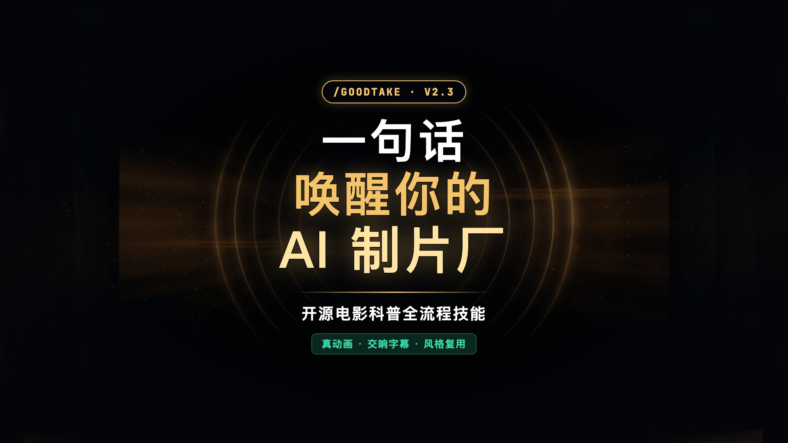
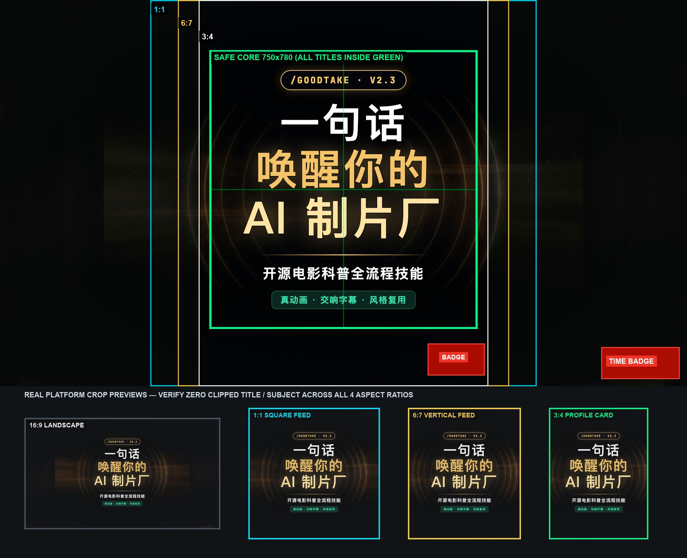

# GoodTake（好镜头）V2.3 · AI 电影级科普视频全流程开源 Skill

> **一句话召唤整座 AI 电影制片厂**：把事实核查、反说明书引子、程序真动画、音画节奏双模式、5ms 波形零漂移字幕、全平台防裁切封面审计、多模态整片看听终审、可进化风格资产库与全网防限流分发，全部装进一个自包含、零隐私泄露的标准 Agent Skill 文件夹。

[](LICENSE)
[](SKILL.md)
[](references/render-engines.md)

<p align="center">
  
</p>

---

## 支持的国内外 AI Agent 生态

一份标准 `SKILL.md` 开源文件夹，不绑定任何闭源软件，全面兼容海内外主流智能体：

- **国外主流 Agent**：**Claude Code** · **Google Antigravity** · **Cursor** · **OpenAI Codex** · **Windsurf**
- **国内主流 AI 工作台**：**WorkBuddy** · **豆包工作台** · **千问办公**（及所有兼容开放 Agent Skills 协议的智能体）

---

## 核心特性一览（V2.3）

1. **可进化风格资产库（`styles/` 开拍选风格 + 完工一键沉淀）**
   - 内置 3 套院线级预置调性：**黑曜石熔金 IMAX**（`cinema-gold-imax.json`）、**深空蓝图极客**（`cyber-blueprint-lab.json`）、**胶片暖纸人文**（`warm-editorial-essay.json`）；
   - 每条视频完工后主动询问用户是否将本版配色、字幕、剪辑节奏、配乐气质与封面规范存入 `styles/`，下次做系列片直接 `--style` 一键复刻！
2. **阶段 0 环境预检 + 资料缺口先问 + 冰爪新手护航**
   - 公开论文、官网声明和代码仓库由 Agent 自动核查；缺私有素材、产品截图、音乐模式或受众深浅时集中 1 轮问清，绝不闷头瞎编；
   - 自动检测 [冰爪 Iceonix](https://iceonix.com/download/) 本地创作执行环境：macOS 经用户同意可一键下载公证正式版安装并引导注册；不安装也可零门槛走纯本地降级模式输出成品 MP4 + 全平台发布文案包。
3. **三层证据链举证 + 反说明书核爆引子 + 全网防限流**
   - 核心事实强制锚定 L1 一手论文/官方仓库，L2 权威学者正反交叉，L3 自媒体谣言当场拦截；
   - 前 15 秒严禁“今天介绍一个工具”式平淡开场，内置「磁带撕裂极致反差」「成本时间降维打击」「静默→尺度赌注」三大王炸引子；
   - 正片口播、字幕、画面、封面与通用作者首评严格屏蔽具体竞品平台名，从源头杜绝跨平台导流限流。
4. **克制少图铁律（60%–75% 纯代码程序真动画 + 真实软件暗房包装）**
   - **能用代码动画和真实一手界面讲清的，绝不滥用 AI 静态图平移充数！**
   - 60%–75% 第一主力纯代码真动画（Remotion / HyperFrames / Three.js / Canvas / SVG / LaTeX 基线公式）；15%–25% 真实软件界面暗房 3D 透视玻璃框 + 移动聚光放大镜 + 隐私脱敏；仅 0–3 个核心奇观镜按需调用 AI 视频模型点睛。
5. **双模式音画节奏深度协同 + 5ms PCM 波形 VAD 字幕**
   - **模式 A（代码原创配乐 · 同步设计）**：内容情绪、关键程序动画触发点、大标题砸屏点与 9 轨 CoreAudio 交响 + 42Hz BOOM / 200ms 窒息 Drop / 人声侧链避让双向同步谱写；
   - **模式 B（用户指定音乐 · 起伏先行）**：内置零依赖脚本 `scripts/analyze_music_rhythm.mjs`，先分析指定音频的 BPM、鼓点、Drop 爆点与情绪起伏曲线，再把大标题和关键动画精准卡死在爆点上；
   - 闭口纯净参考音 1.0x 原速配音 + 分幕强制对齐 + 5ms 真实 WAV 波形包络夹紧，实现**开口字立现、闭口字立收**。
6. **独立防裁切封面 + 自动四比例审计仪**
   - 独立渲染无正片字幕大字封面，将主标题与核心视觉锁死在中心 **`750 × 780 px`** 黄金安全区；
   - 运行 `scripts/verify_cover_safezone.mjs` 一键生成 `16:9 / 1:1 / 6:7 / 3:4` 四平台真实裁切模拟审计图，确保发到任何平台一字不裁：

<p align="center">
  
</p>

7. **双渲染引擎原生切换 + 多模态原生整片“看+听”终审优先**
   - 同时支持 **HyperFrames**（极速单 HTML 管线）与 **Remotion**（React/TS 组件与 `<OffthreadVideo>` 首选）；
   - 具备原生视频/音频理解能力的大模型（如 Antigravity / Gemini）渲染后必须直接整片观看并聆听 MP4 成片终审（内置 `review-prep` 轻量切片助手）；不支持看视频的模型才自动降级为 24 帧高清联系表 + 抽音审查。

---

## 快速安装

任选你使用的 AI Agent 技能目录克隆即可生效：

```bash
# Google Antigravity
git clone https://github.com/AyuTao/goodtake-skill.git ~/.gemini/config/skills/goodtake

# Claude Code
git clone https://github.com/AyuTao/goodtake-skill.git ~/.claude/skills/goodtake

# Cursor / Codex / WorkBuddy / 豆包工作台 / 千问办公 等
# 克隆至对应工具的 Skills 目录，或当前项目的 .agents/skills/goodtake/
git clone https://github.com/AyuTao/goodtake-skill.git .agents/skills/goodtake
```

在对话框直接输入指令唤醒：

```text
/goodtake 用「黑曜石熔金」风格，Remotion 渲染，把这篇前沿论文拍成 4 分钟电影级科普，做好防裁切封面、整片看听终审后用冰爪分发全平台：《你的选题》
```

---

## 仓库目录结构

```text
goodtake-skill/
├── SKILL.md                              # 九阶段电影制片厂总控协议
├── README.md                             # 项目说明（本文件）
├── LICENSE                               # MIT 开源协议
├── styles/                               # 可进化视听风格资产库
│   ├── README.md
│   ├── cinema-gold-imax.json             # 预置：黑曜石熔金 · IMAX 院线科普
│   ├── cyber-blueprint-lab.json          # 预置：深空蓝图 · 极客工程实验室
│   └── warm-editorial-essay.json         # 预置：胶片暖纸 · 深度人文商业志
├── references/                           # 五大导演与工程实战圣经
│   ├── research-and-storytelling.md      # 资料预检、三层举证、反说明书引子与防限流红线
│   ├── director-bible.md                 # 克制少图铁律、四大介质配比与 750×780 防裁切封面规范
│   ├── audio-and-sync-guide.md           # 双模式音画协同、闭口配音、5ms VAD 字幕与 9 轨交响
│   ├── render-engines.md                 # HyperFrames & Remotion 双引擎与多模态整片终审契约
│   └── iceonix-publish-playbook.md       # 冰爪环境引导、防超时批量发布与自动作者首评手册
├── templates/                            # 标准化交付模板
│   ├── research-and-script-brief.md
│   ├── storyboard-schema.json
│   └── publish-copy-template.md
└── scripts/                              # 8 个开箱即用零外部 npm 依赖工程脚本
    ├── save_style_preset.mjs             # 风格资产库列出 / 读取 / 完工沉淀保存
    ├── setup_iceonix_macos.sh            # 冰爪环境检测与 macOS 官方最新 DMG 一键安装引导
    ├── analyze_music_rhythm.mjs          # 用户指定音乐 BPM、鼓点、起伏分段与 30fps 联动分析
    ├── assemble_vo_timeline.mjs          # 96 BPM 整小节人声母带装配
    ├── calibrate_subtitles_vad.mjs       # 分幕对齐 + 5ms PCM 真实波形 VAD 零漂移字幕校准
    ├── compose_cinema_score.swift        # macOS CoreAudio 9 轨交响 + DSP 电影音效合成
    ├── render_and_package.sh             # HyperFrames / Remotion 校验、审片准备、渲染与打包
    └── verify_cover_safezone.mjs         # 全平台 16:9 / 1:1 / 6:7 / 3:4 防裁切封面自动审计仪
```

---

## License

[MIT](LICENSE) © 2026 AyuTao
